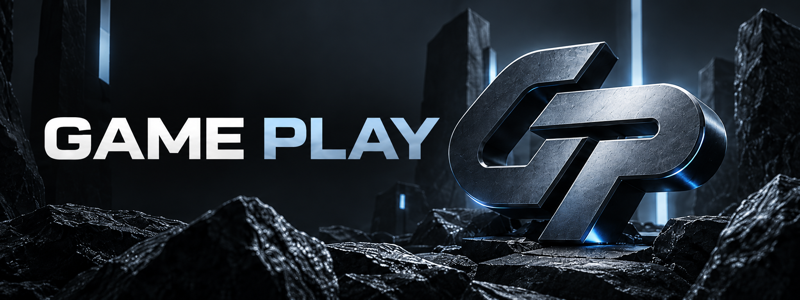

### GAMING COMMUNITY

**Dota 2 • Counter-Strike 2 • Rust • PUBG**

Играй. Развивайся. Найди свою команду.

[Присоединиться к GAME PLAY](https://discord.gg/5ENDb7e4vj) · [English](#english-version)

---

## GAME PLAY | Игровое сообщество

**GAME PLAY** — игровое Discord-сообщество, объединяющее игроков Dota 2, Counter-Strike 2, Rust и PUBG.

Это не просто набор текстовых и голосовых каналов. В основе сообщества работает собственный Discord-бот с системой прогресса, внутренней экономикой, интерактивными панелями и игровыми возможностями.

Мы развиваем пространство, где можно найти команду, общаться, участвовать в активностях и развивать собственный игровой профиль.

### Основные направления

| Игра | Возможности |
|:---|:---|
| Dota 2 | Общение, поиск тиммейтов, игровые разделы |
| Counter-Strike 2 | Поиск команды, общение, игровые разделы |
| Rust | Поиск игроков, командное взаимодействие |
| PUBG | Поиск напарников, общение, игровые разделы |

---

## Возможности GAME PLAY

### Профиль и прогресс

У каждого участника может быть собственный игровой профиль GAME PLAY.

- Внутренний баланс и игровая валюта
- Уровни, опыт и прогресс
- Ежедневные награды
- Клановая принадлежность
- Привязка Steam
- История отдельных экономических операций

### Экономика и активности

Внутренняя экономика объединяет игровые возможности сообщества.

- Получение и использование игровых монет
- Магазин и персональные роли
- Покупка и аренда доступных возможностей
- Мини-игры с внутренней валютой
- Переводы между участниками
- Экономические операции и история

Игровая валюта GAME PLAY используется внутри сообщества и не является реальными деньгами.

### Мини-игры

В системе предусмотрены шесть игровых режимов:

**Слоты · Монетка · Кости · Мины · Кибергонки · Рулетка**

### Steam и персонализация

- Добровольная привязка Steam
- Доступ к поддерживаемой игровой статистике
- Выбор игровых направлений
- Настройка игрового ника
- Персональные роли

### Поддержка и сообщество

- Интерактивная навигация
- Система обращений и тикетов
- Игровые и голосовые комнаты
- Музыкальные возможности
- Инструменты управления сообществом

---

## Собственная Discord-система

GAME PLAY развивается на основе собственного Discord-бота, созданного для объединения игровых и социальных возможностей в одном интерфейсе.

**Основные принципы проекта:**

- Единое визуальное оформление
- Удобная навигация через кнопки и панели
- Связанная система профилей и экономики
- Разделение пользовательских и административных возможностей
- Последовательное развитие без пересоздания сервера

Проект развивается поэтапно. Наличие функции в архитектуре не означает, что все её сценарии уже прошли окончательную проверку.

---

## Развитие проекта

Мы работаем над расширением возможностей GAME PLAY.

**В планах и разработке:**

| Направление | Планируемые возможности |
|:---|:---|
| Профиль | Расширенная карточка игрока и GAME PLAY ID |
| Инвентарь | Предметы, коллекции и трофеи |
| Контракты | Задания с игровыми наградами |
| Достижения | Долгосрочные цели и прогресс |
| Экономика | Новые способы заработка и использования монет |
| Рынок | Торговля, аукционы и крафт |
| Кланы | Казна, улучшения и совместные цели |
| Сообщество | Поиск команды, события и турниры |
| Сезоны | Сезонные рейтинги и награды |

**Важно:** перечисленные возможности относятся к планам или глобальному обновлению и не заявляются как полностью доступные на действующем сервере.

Наша цель — расширять GAME PLAY, сохраняя привычное оформление, существующие профили, данные и пользовательские интерфейсы. Совместимость обновления проходит отдельную проверку.

---

## Присоединиться к GAME PLAY

**Твоя игра. Твоя команда. Твой прогресс.**

[Открыть Discord-сервер](https://discord.gg/5ENDb7e4vj)

---

## English Version

### GAME PLAY | Gaming Community

**GAME PLAY** is a Discord gaming community built around Dota 2, Counter-Strike 2, Rust, and PUBG.

The community features a custom Discord bot that brings together player profiles, progression, virtual currency, interactive panels, gaming activities, and community tools.

### Community Features

- Player profiles, levels, and XP
- Virtual currency and daily rewards
- Custom roles and an in-server shop
- Mini-games and gaming activities
- Clan membership and Steam integration
- Game selection and teammate discovery channels
- Music, voice channels, and support tickets
- Interactive navigation and community management

### Future Development

We are working on expanded player profiles, inventory, achievements, contracts, advanced clan systems, trading, events, tournaments, and seasonal progression.

These features are planned or under development and are not presented as fully released.

Our goal is to expand the existing community while preserving its familiar design, user data, and core functionality, subject to compatibility testing.

### Join the Community

**Your Game. Your Team. Your Progress.**

[Join GAME PLAY on Discord](https://discord.gg/5ENDb7e4vj)

---

GAME PLAY | Gaming Community

Developed by <a href="https://github.com/BotZavod">BOT ZAVOD</a>

