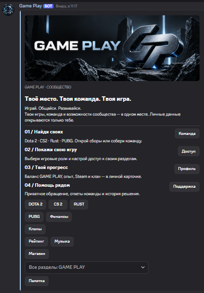
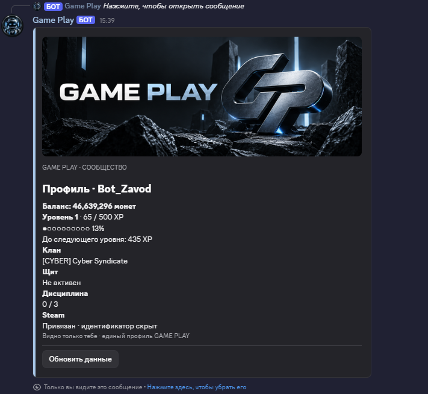
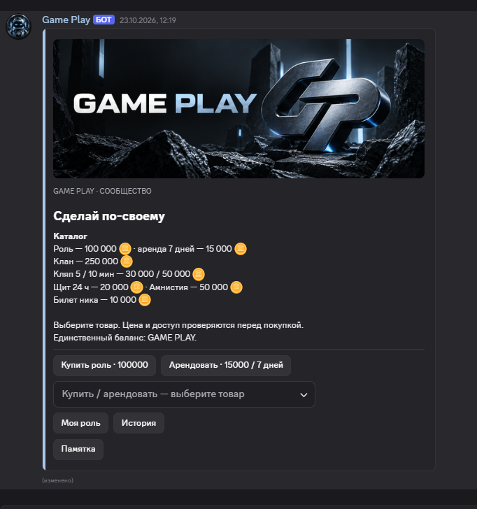
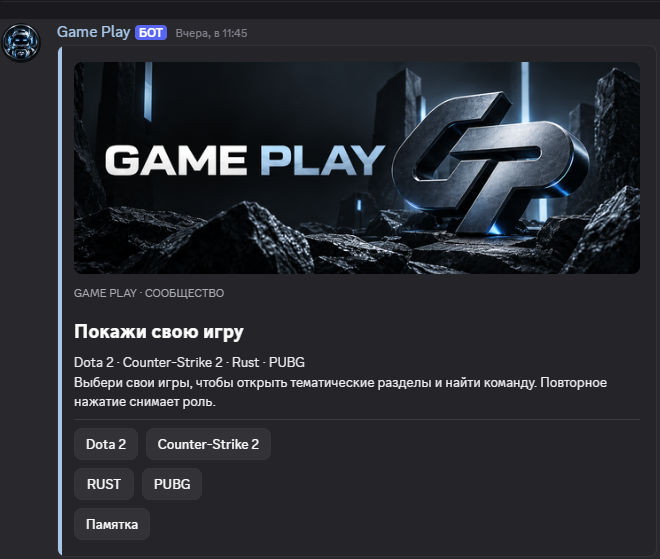
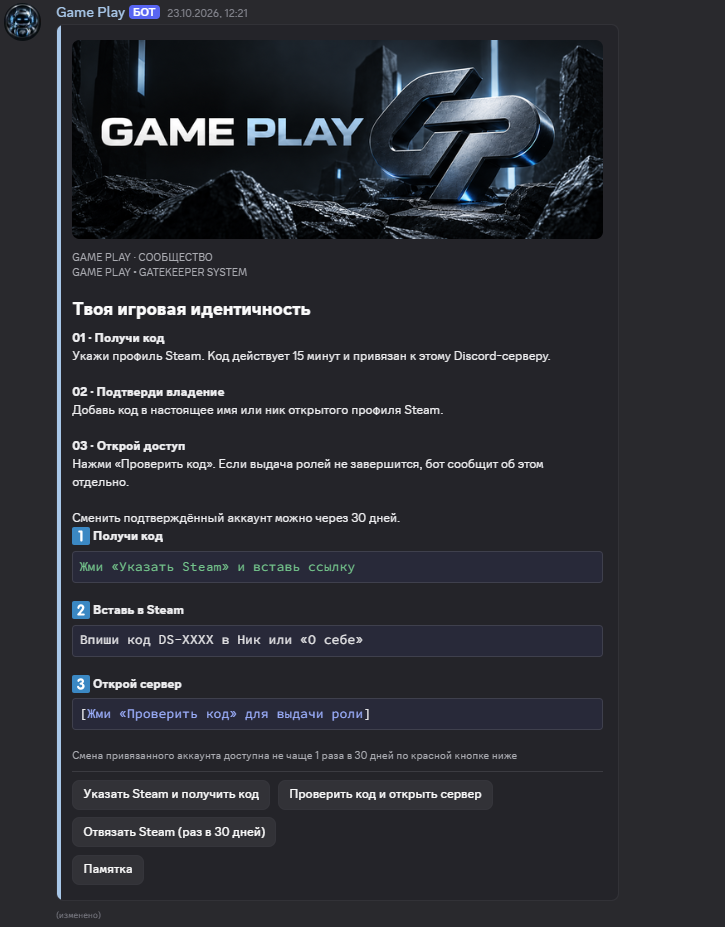
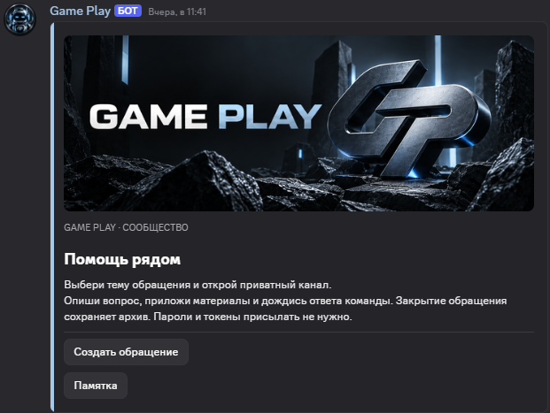

# GAME PLAY | Интерфейсы и возможности

**GAMING COMMUNITY • CUSTOM DISCORD BOT**

**Dota 2 • Counter-Strike 2 • Rust • PUBG**

Собственное игровое сообщество с интерактивным Discord-ботом, системой прогресса, экономикой и инструментами управления.

[🏠 Главная](../README.md) · [📸 Интерфейсы](#интерфейсы-game-play) · [⚙️ Возможности](#возможности-сообщества) · [🗺️ Roadmap](ROADMAP.md) · [🇬🇧 English](#english-version)

**[🎮 Присоединиться к GAME PLAY](https://discord.gg/5ENDb7e4vj)**

---

# 🇷🇺 Русская версия

## О проекте

**GAME PLAY** — игровое Discord-сообщество, объединяющее игроков Dota 2, Counter-Strike 2, Rust и PUBG.

В основе проекта работает собственный Discord-бот, разработанный для автоматизации сообщества и создания единой игровой экосистемы.

**Основные направления:**

| Направление | Возможности |
|---|---|
| Игровое сообщество | Общение, игровые разделы, поиск команды |
| Профили | Уровни, XP, баланс, Steam, кланы |
| Экономика | Монеты, магазин, персональные роли |
| Развлечения | Мини-игры, игровые активности |
| Персонализация | Игровые роли, настройки участника |
| Поддержка | Тикеты и обращения |
| Администрирование | Интерактивные панели управления |

Все представленные ниже изображения являются скриншотами существующего интерфейса GAME PLAY.

**Нажми на изображение, чтобы открыть его в полном размере.**

---

## Интерфейсы GAME PLAY

### 01. Навигация по серверу

**Единая система навигации**

Главная интерактивная панель объединяет основные направления сервера.

Участникам доступны переходы к игровым разделам, профилю, экономике, поддержке и другим возможностям сообщества.

Навигация организована через кнопки и выпадающее меню, без необходимости запоминать большое количество команд.

---

### 02. Профиль игрока

**Персональный профиль GAME PLAY**

Каждый участник может пользоваться собственным игровым профилем.

| Элемент | Описание |
|---|---|
| Баланс | Внутренняя валюта сообщества |
| Уровень | Прогресс участника |
| XP | Опыт и развитие |
| Клан | Принадлежность к игровому объединению |
| Щит | Статус игровой защиты |
| Steam | Информация о привязанном аккаунте |

Профиль объединяет основные игровые данные пользователя в одной интерактивной карточке.

---

### 03. Экономика и магазин

**Внутренняя игровая экономика**

GAME PLAY использует собственную виртуальную валюту для игровых возможностей сообщества.

Участникам доступны покупка и аренда персональных ролей, отдельные игровые услуги и история операций.

Перед выполнением покупки система проверяет необходимые условия.

Виртуальные монеты GAME PLAY используются исключительно внутри сообщества и не являются реальными деньгами.

---

### 04. Выбор игры

**Игровые направления**

Участник может выбрать интересующие его игры и получить доступ к соответствующим тематическим разделам.

| Игра | Направление |
|---|---|
| Dota 2 | Общение и поиск команды |
| Counter-Strike 2 | Игровые разделы и тиммейты |
| Rust | Поиск игроков и команд |
| PUBG | Общение и поиск напарников |

Игровые роли помогают организовать сообщество и упростить поиск единомышленников.

---

### 05. Подтверждение Steam

**Интерактивное подтверждение Steam**

В GAME PLAY предусмотрена система подтверждения Steam-аккаунта через интерактивную панель.

Участник указывает профиль Steam, получает проверочный код и подтверждает владение аккаунтом.

После успешной проверки бот предоставляет предусмотренные сервером роли и доступы.

Требования к Steam-подтверждению зависят от настроек соответствующих разделов сообщества.

---

### 06. Поддержка участников

**Интерактивная система обращений**

Участники могут обращаться к администрации через специальную панель.

Система предусматривает создание приватных обращений, взаимодействие с командой сервера и сохранение истории в рамках предусмотренных механизмов.

Поддержка интегрирована в основную систему GAME PLAY.

---

## Возможности сообщества

### Профили и прогресс

Игровая система объединяет персональные профили, уровни, опыт, баланс и ежедневные награды.

Участники могут отслеживать развитие своего профиля и использовать заработанные виртуальные монеты внутри сообщества.

### Мини-игры

В боте предусмотрено шесть игровых режимов:

| Игра | Режим |
|---|---|
| Слоты | Игровой автомат |
| Монетка | Выбор стороны монеты |
| Кости | Игра с кубиками |
| Мины | Игровое поле с риском |
| Кибергонки | Виртуальные соревнования |
| Рулетка | Игровая рулетка |

Мини-игры используют исключительно внутреннюю виртуальную валюту GAME PLAY, не имеющую денежной стоимости.

### Кланы и персонализация

Возможности сообщества включают:

- Клановую принадлежность.
- Персональные роли.
- Покупку и аренду доступных возможностей.
- Изменение игровых настроек.
- Интерактивные панели участников.

### Музыка и голосовые возможности

В архитектуре сервера предусмотрены музыкальные функции, голосовые комнаты и инструменты управления ими.

Отдельные сценарии музыкальных и голосовых функций продолжают проходить проверку.

### Администрирование

Собственный административный центр объединяет инструменты управления сервером.

| Раздел | Назначение |
|---|---|
| Каналы и роли | Настройки структуры сервера |
| Модерация | Инструменты управления участниками |
| Экономика | Административные операции |
| Поддержка | Управление обращениями |
| Голосовые комнаты | Настройки голосовых возможностей |
| Диагностика | Проверка отдельных систем |

Доступ к административным операциям ограничивается соответствующими правами.

---

## Собственная Discord-система

GAME PLAY использует собственного Discord-бота, созданного специально для этого сообщества.

**Технологическая основа:**

- Python.
- Discord API.
- Интерактивные Discord-компоненты.
- Система хранения пользовательских данных.
- Модульная организация функций.
- Управление доступом и правами.

Проект ориентирован на удобство участников, автоматизацию повседневных операций и дальнейшее расширение возможностей.

### Особенности интерфейса

- Единая тёмная визуальная стилистика.
- Собственные баннеры GAME PLAY.
- Интерактивные кнопки и меню.
- Компактная навигация.
- Контекстные памятки.
- Разделение пользовательских и административных возможностей.

---

## Развитие проекта

GAME PLAY продолжает развиваться. В работе находится глобальное расширение возможностей существующего Discord-бота.

**Основные направления развития:**

- Расширение игровой экономики и системы прогресса.
- Развитие клановых механик и совместных активностей.
- Новые игровые предметы, трофеи и достижения.
- Улучшение интерактивных панелей и административных инструментов.
- Повышение стабильности и безопасности системы.

Совершенствование автоматической модерации рассматривается как отдельное отложенное направление.

### Принцип обновления

Глобальное обновление разрабатывается с целью сохранить:

- Существующий Discord-сервер и приложение бота.
- Категории, каналы и роли.
- Баннеры и утверждённый дизайн.
- Опубликованные панели.
- Профили и пользовательские данные.
- Балансы, XP и уровни.
- Steam-привязки и кланы.
- Историю операций.
- Работоспособность существующих функций.

Совместимость и безопасность изменений проходят отдельную проверку перед внедрением.

**Планируемые функции не считаются доступными до их фактического выпуска.**

[🗺️ Полная дорожная карта GAME PLAY](ROADMAP.md)

---

## Присоединиться к GAME PLAY

**Твоя игра. Твоя команда. Твой прогресс.**

[🎮 Открыть Discord-сервер](https://discord.gg/5ENDb7e4vj)

[🏠 Вернуться на главную](../README.md) · [🗺️ Дорожная карта](ROADMAP.md)

---

# English Version

## GAME PLAY | Interfaces & Features

**GAME PLAY** is a gaming Discord community built around Dota 2, Counter-Strike 2, Rust, and PUBG.

The community features a custom Discord bot that brings together player profiles, progression, virtual currency, interactive panels, gaming activities, and administration tools.

[🏠 Home](../README.md) · [📸 Interface Gallery](#interface-gallery) · [⚙️ Additional Features](#additional-features) · [🗺️ Roadmap](ROADMAP.md)

### Main Features

| Area | Features |
|---|---|
| Gaming Community | Communication, game sections, teammate discovery |
| Player Profiles | Levels, XP, balance, Steam, clans |
| Economy | Virtual coins, shop, custom roles |
| Entertainment | Mini-games and gaming activities |
| Personalization | Game roles and member settings |
| Support | Private support tickets |
| Administration | Interactive management panels |

---

## Interface Gallery

The following screenshots show real interfaces from the existing GAME PLAY bot.

**Click any screenshot to view the full-size image.**

### 01. Server Navigation

**Interactive Server Navigation**

The main navigation panel connects the community's essential features in one place.

Members can access game sections, player profiles, the economy, support, and other services through interactive buttons and dropdown menus.

The interface is designed to reduce reliance on text commands.

---

### 02. Player Profile

**Personal GAME PLAY Profile**

Each member can access a personal gaming profile.

| Element | Description |
|---|---|
| Balance | Community virtual currency |
| Level | Player progression |
| XP | Experience and development |
| Clan | Clan membership |
| Shield | In-game protection status |
| Steam | Linked account information |

The profile brings essential player information together in a single interface.

---

### 03. Economy & Shop

**Community Virtual Economy**

GAME PLAY includes a virtual currency system for community activities.

Members can purchase or rent available custom roles, access selected services, and review transaction history.

The system checks relevant conditions before processing purchases.

GAME PLAY coins are used exclusively within the community and have no real-world monetary value.

---

### 04. Game Selection

**Game-Specific Community Sections**

Members can select their preferred games and access the corresponding community sections.

| Game | Community Features |
|---|---|
| Dota 2 | Communication and team discovery |
| Counter-Strike 2 | Game discussions and teammates |
| Rust | Player and team discovery |
| PUBG | Communication and squad discovery |

Game roles help organize the community and make it easier to connect with other players.

---

### 05. Steam Verification

**Interactive Steam Account Verification**

GAME PLAY provides an interactive Steam account verification system.

Members submit their Steam profile, receive a verification code, and confirm account ownership.

After successful verification, the bot grants the roles and access configured for the community.

Steam verification requirements depend on the settings of the relevant server sections.

---

### 06. Member Support

**Interactive Support System**

Members can contact the administration team through a dedicated support panel.

The system supports private requests, communication with the server team, and request history within its configured mechanisms.

Support is integrated directly into the GAME PLAY bot.

---

## Additional Features

### Player Progression

The community includes personal profiles, experience points, levels, virtual balances, and daily rewards.

Players can track their progress and use virtual coins within the community.

### Mini-Games

The existing bot includes six game modes:

| Game | Mode |
|---|---|
| Slots | Virtual slot game |
| Coin Flip | Coin-side selection |
| Dice | Dice game |
| Mines | Risk-based game board |
| Cyber Racing | Virtual racing |
| Roulette | Virtual roulette |

These activities use only GAME PLAY virtual currency, which has no monetary value.

### Clans & Personalization

The system includes clan membership, custom roles, role purchases and rentals, member settings, and interactive user panels.

### Music & Voice

The server architecture includes music features, voice channels, and voice management tools.

Some music and voice scenarios are still undergoing integration testing.

### Administration

The custom administration center provides tools for:

- Channel and role configuration.
- Member moderation.
- Economy management.
- Support request handling.
- Voice channel configuration.
- System diagnostics.

Administrative actions are restricted by the appropriate permissions.

---

## Custom Discord System

GAME PLAY is powered by a custom Discord bot developed specifically for the community.

**Technology:**

- Python.
- Discord API.
- Interactive Discord components.
- Persistent user data.
- Modular functionality.
- Role-based access control.

### Interface Design

The project follows a consistent visual identity:

- Dark interface styling.
- Custom banners.
- Interactive buttons and menus.
- Compact navigation.
- Contextual help.
- Separate member and administration controls.

---

## Future Development

GAME PLAY continues to evolve through a major expansion of the existing Discord bot.

**Key development directions:**

- Expanded virtual economy and player progression.
- Enhanced clan mechanics and cooperative activities.
- New collectible items, trophies, and achievements.
- Improved interactive panels and administration tools.
- Greater system reliability and security.

Advanced automated moderation is a separate, deferred development direction.

### Update Philosophy

The global upgrade is designed to extend the existing GAME PLAY community while preserving:

- The existing Discord server and bot application.
- Categories, channels, and roles.
- Custom banners and established visual design.
- Published interactive panels.
- Player profiles and stored data.
- Virtual balances, XP, and levels.
- Steam links and clan information.
- Transaction history.
- Existing working functionality.

Compatibility and security are reviewed before deployment.

**Planned features are not considered available until officially released.**

[🗺️ Full GAME PLAY Development Roadmap](ROADMAP.md)

---

## Join GAME PLAY

**Your Game. Your Team. Your Progress.**

**[🎮 Join Our Discord Community](https://discord.gg/5ENDb7e4vj)**

[🏠 Back to Main Page](../README.md) · [🗺️ Roadmap](ROADMAP.md)

---

## Development & Contacts

**GAME PLAY | GAMING COMMUNITY**

Developed by **BOT ZAVOD**

Custom Discord Bots • Interactive Systems • Automation

[👨‍💻 BOT ZAVOD Portfolio](https://github.com/BotZavod) · [🛒 FunPay](https://funpay.com/users/14765417/) · [💬 Discord](https://discord.gg/5ENDb7e4vj)

---

GAME PLAY · Gaming Community · Custom Discord Systems

